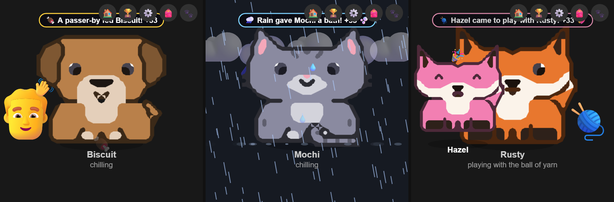
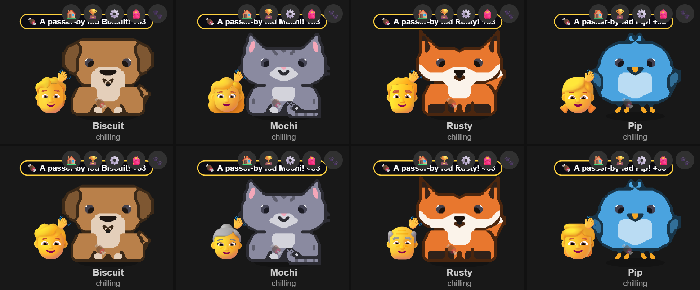
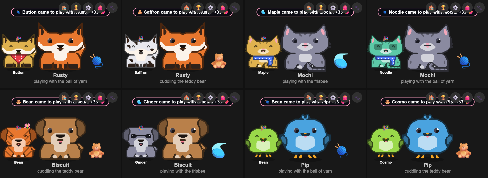
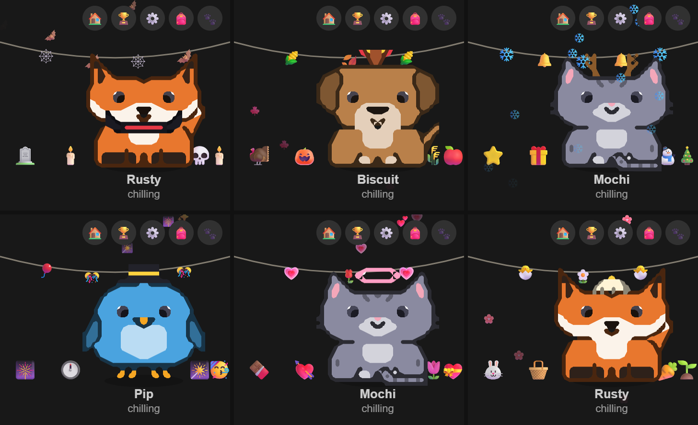
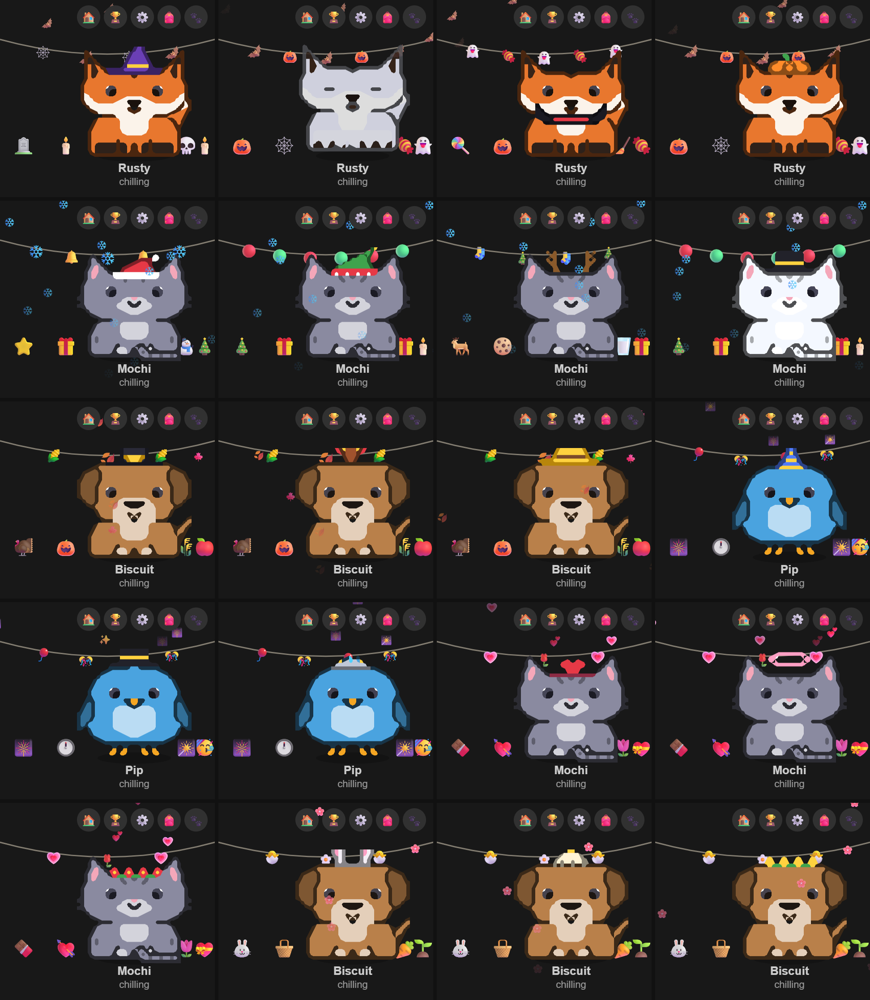
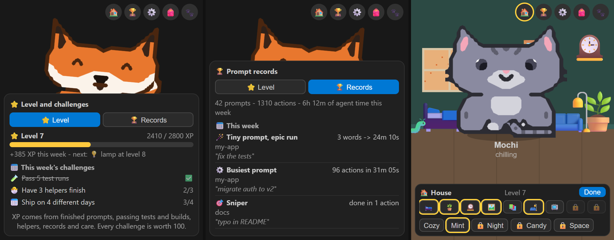
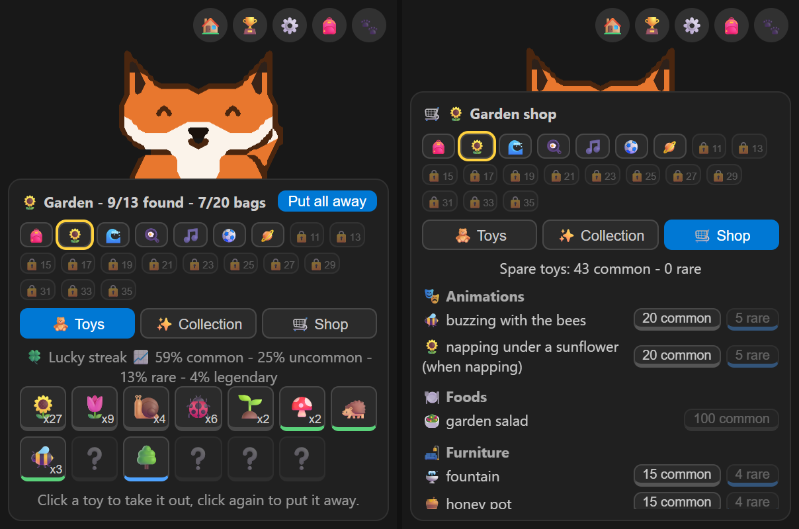
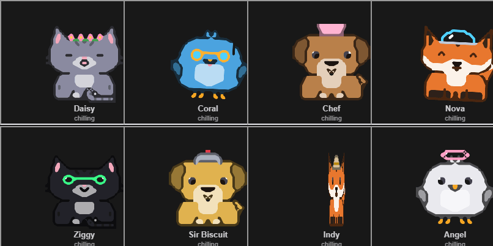
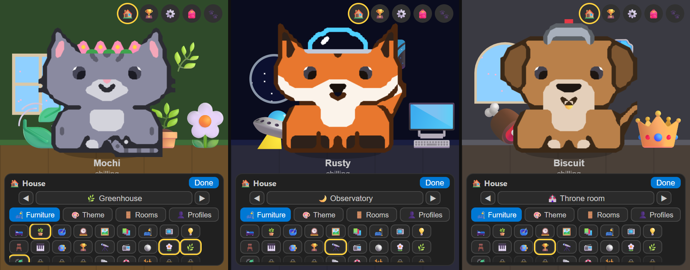
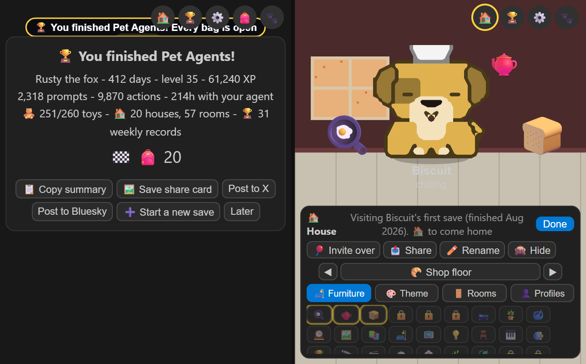

# Pet Agents

[](https://marketplace.visualstudio.com/items?itemName=bheck890.pet-agents)
[](LICENSE)

**A pixel pet in your VS Code sidebar that acts out what your AI coding agent is doing, live.**
It reads files with a magnifying glass, types on a laptop, watches the washing machine while your tests run, throws a tantrum when a tool call fails and puts on a party hat when the task is done. When the agent starts sub-agents, mini pets pop out with funny names and their task written underneath.


Works with **Claude Code** out of the box, and with Cursor, Codex, OpenCode and Kiro through [peon-ping](https://github.com/PeonPing/peon-ping). Read-only, offline, no account.

---

## Install

In VS Code, open the Extensions view (`Ctrl+Shift+X`), search for **Pet Agents** and click **Install**. Or press `Ctrl+P` and run:

```
ext install bheck890.pet-agents
```

Then open the **Explorer** sidebar: your pet lives in the **Pet Agents** panel. Drag the panel taller if it feels cramped, especially when sub-agents are running.

---

## Pick your pet

A fox, cat, dog or bird, each drawn in code as recolourable pixel art.


Run **Pet Agents: Customize Pet** for a menu of everything below. Every change shows up live and the menu stays open so you can keep tweaking. There is also **Randomize look** and **Reset look to defaults**.


- **Colours:** fur, belly/muzzle, eyes and accessory. Pick a preset or any CSS colour (`#ff8800`, `hotpink`, `rebeccapurple`...).
- **Patterns:** spots, stripes, white socks, bandit mask, eye patch.
- **Accessories:** bow, flower, crown, beanie, headphones, glasses, sunglasses, bandana, scarf, collar with a bell tag. Hats step aside when a state needs the party hat or nightcap.
- **Art style:** `smooth` (rounded, soft edges) or `pixel` (crisp retro blocks).
- **Ask your AI.** Tell your agent something like _"give my VS Code pet a gold crown and blue eyes"_. It edits your settings and the pet changes immediately.

---

## Your pet acts out the agent

Each state has its own pose, expression, prop and a ring of emojis orbiting the pet. By default the pet is also tinted and glows with a colour for the state: purple for thinking, blue for writing, red for errors, gold when done (`pet-agents.stateColors`).

| Agent is...                  | Pet does                                          | Orbiting emojis |
| ---------------------------- | ------------------------------------------------- | --------------- |
| Thinking                     | Tilts its head, thought bubble with animated dots | 💭 🤔 💡 ✨     |
| Reading / searching files    | Holds a magnifying glass, eyes look down          | 🔍 📖 📄 👀     |
| Editing files                | Types on a laptop, tongue out in concentration    | ✏️ 📝 ⌨️ 💾     |
| Running commands             | Runs in place, sweat drops and dust puffs         | ⚙️ 🔧 ⚡ 💻     |
| Running tests                | Sits by a machine and watches it work             | 🧪 ⏳ 🔬 🫧     |
| Browsing the web / MCP tools | Looks through binoculars                          | 🌐 🔗 📡 🛰️     |
| Starting sub-agents          | Holds a clipboard while mini pets spawn           | 📋 📣 👥 🧩     |
| Waiting for you              | Hops, with a flashing `!` / `?` speech bubble     | ❓ ❗ 🙋 ⏳     |
| A tool call failed           | Storm cloud overhead, shakes, angry eyes          | 💢 💥 ⚠️ 🐛     |
| Finished the task            | Party hat, jumps, confetti                        | 🎉 ⭐ 🏆 ✅     |
| Idle for a while             | Nightcap, snot bubble, floating Zzz               |                 |

The pet also blinks, wags its tail (or flaps its wings), twitches its ears, and wakes up with a stretch and a yawn when work starts.

Once the agent does the same kind of thing twice in a row (two web searches, two file writes...), the pet keeps doing it, however long the agent thinks in between, until something different happens: another kind of tool call, an error, a question for you, or the end of the turn. A single action is held for 8 seconds of thinking, so it doesn't flicker back and forth.

### Never the same twice

With `pet-agents.variety` set to `random` (the default), every state picks one of several animations each time it starts. The pick comes from the agent's transcript, so the same agent does the same animation in every VS Code window, whether it's the main pet in one and a mini pet in another. Set it to `classic` to always get the looks in the table above.


| State      | Variants                                                                                                                  |
| ---------- | ------------------------------------------------------------------------------------------------------------------------- |
| Napping    | nightcap, sideways, rolling over from side to side, belly-up, as a loaf, in a cardboard box, in a bed, on a perch (birds) |
| Thinking   | thought bubble, light bulb idea, pacing, over coffee, levitating meditation, maths on a chalkboard                        |
| Reading    | magnifying glass, a book, sniffing out clues, buried in a stack of books, ancient scrolls                                 |
| Writing    | laptop, mechanical keyboard with flying code, scribbling on a notepad, hacker mode                                        |
| Running    | running in place, hamster wheel, tinkering with a wrench, zoomies, running in circles, flying laps (birds)                |
| Testing    | watching the machine, eating popcorn, nervously, pacing, fingers crossed                                                  |
| Browsing   | binoculars, telescope, surfing the web on a surfboard, satellite dish, scouting from the sky (birds)                      |
| Delegating | clipboard, megaphone, conducting the team with a baton                                                                    |
| Waiting    | `!` / `?` bubble, holding up a sign, tapping its foot, waving at you                                                      |
| Error      | storm cloud, fuming, throwing a tantrum, flopping over                                                                    |
| Done       | party hat, raising a trophy, victory dance, backflip                                                                      |

Don't like one? Open the ⚙️ button in the pet panel, expand **Actions** and untick it (or list it in `pet-agents.disabledActions`, e.g. `running.zoomies`). It never plays again; if you untick every variant of a state, that state uses its classic look.

---

## Sub-agents become mini pets

Every sub-agent the agent starts appears as a mini version of your pet in its own colour, lined up along the bottom of the panel. Each one gets a name that fits its job (explorers become "Detective Noodle" or "Scout Waffles", planners become "Professor Pickles", reviewers become "Inspector..."), with its task shown underneath. Minis act out their own state, celebrate when they finish, then vanish in a puff.


A second Claude Code session in the same workspace (say, another chat in this window) that was busy in the last couple of minutes joins them as a mini named after the folder it was started in (`pet-agents.backgroundPets`).

The row belongs to this repo's agents. When none are running here, busy sessions from your other repos (other VS Code windows) fill it instead, labelled with their repo name, so you can keep an eye on them. They step aside the moment a helper starts in this repo and never take over this window's pet (`pet-agents.otherRepoPets`).

## Machines for tests and jobs

Every test run, build and background shell command gets a machine next to your pet: a washing machine, oven, microwave, computer, engine or server rack, each with its own animation (spinning socks, a glowing oven window, scrolling test output, turning gears, blinking lights). When a job finishes its machine dings 🔔 and goes away. Hover a machine to see its command and how long it has been running (`pet-agents.machines`).


---

## It has a life of its own

When the agent is quiet, your pet gets up to things: chasing a butterfly, bird watching, digging, dancing, daydreaming, reading, having a coffee, yoga, rolling around, running in circles, and playing with its toys. It strolls around the panel (`pet-agents.wander`) and runs back to its spot the moment the agent starts working. Its pupils follow your mouse.


**Pet it.** Click for hearts 💖, double-click for a spin-jump trick ⭐. Clicking a napping pet wakes it up. Mini pets like attention too.

### Toys, furniture and the bag

Every few minutes your pet finds something new (`pet-agents.toys`), and every find goes into its 🎒 bag:

| Rarity    | Chance | Examples                                                                              |
| --------- | ------ | ------------------------------------------------------------------------------------- |
| Common    | 62%    | 🧶 yarn, 📦 box, 🦴 bone, 🧸 teddy, 🥏 frisbee, 🪴 plant, 🎈 balloon                  |
| Uncommon  | 25%    | 🪑 chair, 🛋️ couch, 🛏️ bed, 🎸 guitar, 🥁 drum, 🛹 skateboard, 🪁 kite, 🏀 basketball |
| Rare      | 10%    | 🚀 rocket, 🕹️ arcade stick, ⛺ tent, 🛸 tiny UFO, 🏰 castle                           |
| Legendary | 3%     | 👑 golden crown, 💎 giant diamond, 🦄 unicorn plush, 🌈 pocket rainbow                |

A new find shows off on the floor for a minute (rarer ones glow and sparkle, and a banner announces them), then flies into the bag. When your pet fancies a play it pulls something out: it chases the yarn, hides in the box, lounges on the couch, rides the skateboard, jams on the guitar or admires the treasure, then puts it back.

**Play with it.** Every find is either a real **toy** or an **object**:

- **Toys** (🧶 yarn, 🦴 bone, 🧸 teddy, 🥏 frisbee, 🎈 balloon, 🛹 skateboard, 🪁 kite, 🏀 basketball, 🚀 rocket, 🛸 UFO, 🦄 unicorn): click one on the floor to flick it across the panel. Your pet chases it and plays with it.
- **Objects** (📦 box, 🪴 plant, 🪑 chair, 🛋️ couch, 🛏️ bed, 🎸 guitar, 🥁 drum, 🕹️ arcade stick, ⛺ tent, 🏰 castle, 👑 crown, 💎 diamond, 🌈 rainbow): click one and your pet comes over to use it: sits, naps, hides, jams or admires.

A napping pet wakes up to play. While the agent is working, toys still fly but your pet stays at work. Right-click a toy or object to put it back in the bag.

Click 🎒 to see the active bag: every slot, with ❔ for ones you haven't found yet. Click a toy to take it out, click again to put it away. Bags are shared by every VS Code window and survive reloads and reinstalls. As you level up, more themed bags open (see [Bags](#bags)).

### The shop

The bag has three tabs: **🧸 Toys** (your finds), **✨ Collection** (what you've bought) and **🛒 Shop**. In the shop you trade spare toys for new things. Only spares are traded in, so you always keep one of each toy you've found. Every bag has its own shop, paid for with that bag's spares; the starter bag's sells:

| For sale   | Price                   | What you get                                                                                                                                                   |
| ---------- | ----------------------- | -------------------------------------------------------------------------------------------------------------------------------------------------------------- |
| Animations | 20 common **or** 5 rare | 🪩 disco dancing, 🎩 magic tricks, 🫧 blowing bubbles, 🔭 stargazing, 🌀 spinning, 🎉 party (idle hobbies), 💤 sweet dreams (napping), 🎊 victory party (done) |
| Foods      | 100 common              | 🐟 fresh fish, 🥩 steak, 🍓 strawberries, 🍰 cake                                                                                                              |
| Rooms      | 30 common **or** 8 rare | the 🏡 cozy home's kitchen and yard                                                                                                                            |

Bought animations join the random mix (and the ⚙️ action list, where locked ones show 🔒). In ✨ Collection you pick which food 🍖 Feed drops, and switch each bought animation on or off. Bought foods can also be picked under the care buttons.

### Take care of it

Click 🐾 to open care mode. Three stats wear down slowly in real time, even while VS Code is closed: 🍖 fullness, 💖 happiness and 🫧 cleanliness. Care is hands-on: pick a tool and actually do it.


| Tool      | What you do                                                        | What your pet does                                              |
| --------- | ------------------------------------------------------------------ | --------------------------------------------------------------- |
| 🍖 Feed   | Your cursor becomes a bowl. Click to drop kibble (up to 6 pieces). | Trots over to each piece and eats it, crumbs flying             |
| 🍪 Treat  | Hold the cookie on your cursor, then click to drop it.             | Begs and hops when it's held above its head, catches it mid-air |
| 🎾 Play   | Grab the ball and fling it. It bounces off the floor and walls.    | Chases it and brings it back to where you threw from            |
| 🛁 Bath   | Your cursor becomes a sponge. Hold the button and scrub.           | Foam builds up and dirt fades. At 100% it does a big wet shake  |
| 💖 Stroke | Hold the button and rub your pet back and forth.                   | Wiggles happily with hearts                                     |

**Close the panel, keep the tool.** Pick a tool, then click 🐾 again to tuck the panel away and get the space back. The tool stays in your hand (the 🐾 button shows it, e.g. 🍖) until you press Esc, open the bag or settings, or the agent starts working.

Every bit of care ends with the happy wiggle and hearts you get for petting it, whether it was you or a visitor who looked after it.

Your pet has opinions: it won't eat when it's full, and is too hungry to play when starving. When a stat is low you'll see it: dirt smudges on its fur, and "hungry", "bored" or "needs a bath" under its name.

**No treats on the clock.** While the agent is working, or any of its helper pets are out, care is locked and clicking the pet just gets a 🛠️ "busy working" bubble. Care unlocks as soon as the task is done.


### Visitors



A pet that needs looking after gets help. While any care stat is at 40 or below, someone looks in every 40 minutes, and every 30 once all three are at zero: a passer-by stops to feed it, or a rain shower gives it a bath, whichever helps, each topping up a third of that stat. Very rarely, a friend of its own kind drops in to play with a toy from its bag. Every friend is a new, randomly made-up pet of the same species, with its own colour, markings, accessory and name. Look after your pet yourself and the next visit is put off for an hour; keep every stat above 40 and nobody comes. Each visit happens once however many windows are open, and visitors are switched off with `pet-agents.visitors` or in ⚙️.





### Quick settings and tooltips

The ⚙️ button switches things on and off without leaving the panel: random animations and hobbies, wandering, new toys, machines, pets for other sessions, state colours, and each individual action. Changes are saved to your VS Code settings. **🪵 Gather debug logs** at the bottom writes a snapshot of the view and the extension to the Pet Agents log and opens it.

Hover any pet for details: what it is doing, which file, which project, its care stats and how many helpers and jobs are running. The **session dots** in the top-left corner show your other active agent sessions (bright green = active, dark green = idle, grey = cold). **Drag** your pet anywhere in the panel; the position is remembered.


---

## A pet for the long haul

Leave it open for weeks and there is always something going on. Every part is optional: switch each one off with its setting or in the ⚙️ panel.

### Holidays



Halloween, Thanksgiving, Christmas, New Year, Valentine's Day and Easter, worked out from your local date: your pet dresses up, decorations go up either side of it with a garland above, and bats, leaves, snow, fireworks, hearts or blossom drift by. Every holiday has several outfits and sets of decorations, and each window picks its own when it opens: for Christmas your pet might be Santa, an elf, a reindeer or a snowman; for Halloween a witch, a ghost, a vampire or a pumpkin.


Each holiday has a toy you can only find while it is on (a 🎃 jack-o-lantern, a ⛄ snowman...), and you keep it forever. Your own accessory wins if it wants the same spot as the costume (`pet-agents.holidays`).

### Levels, challenges and prompt records



The 🏆 button shows your level and this week's records:

- **XP** comes from finished prompts, passing test runs and builds, helpers that finish, records you set and looking after your pet. It is counted once per prompt or run however many VS Code windows are open, and nothing is lost when you are away: after a week off, your first three prompts earn double.
- **Three challenges every Monday**, the same in every window: pass 5 test runs, have 3 helpers finish, ship on 4 different days...
- **Weekly prompt records**, worked out from your Claude Code transcripts: 🪄 the tiniest prompt with the longest run, 📜 the longest prompt that finished fastest, ⚙️ the busiest prompt, 🎯 the one done in the fewest actions, 🐣 the most helpers and ⏱️ the marathon, plus an all-time hall of fame. The first time you open it, it reads back through this week's transcripts. The board shows numbers and the repo only; turn on `pet-agents.recordsShowPrompts` to see the start of each prompt as well. Nothing leaves your machine.

### Bugs to squash

A failing test run lets a 🐛 bug into the panel and a failing build a 👾 gremlin; the next passing run of the same kind squashes them, for XP. Leave the agent waiting for your OK for a minute and a 🦠 slime creeps up until you answer (`pet-agents.enemies`).

### Bags



Levels open new **bags**, 20 in all: one at each of levels 1 to 5, then one every 2 levels up to 35. Each is a themed pack: 🌻 Garden, 🌊 Ocean, 🍳 Kitchen, 🎵 Music, ⚽ Sports, 🪐 Space, 👻 Spooky, 💾 Retro tech, 🚜 Farm, 🏕️ Camping, 🎨 Art studio, 🔬 Science lab, ❄️ Winter, 🌴 Jungle, 🏰 Castle, 🤖 Robots, 🌵 Desert, ☁️ Sky and the 💎 Legendary vault, where legendary finds turn up far more often. Pick the active bag at the top of the 🎒 panel (locked ones show the level that opens them). New finds come from its catalogue of 12 or more toys, and its 🛒 shop sells its goodies for its own spares. Switching never loses anything, every window follows the switch, and holiday toys still turn up during their event whichever bag is active. With `pet-agents.levels` off, every bag is open.

Every bag after the first is a whole pack:

| Part           | Comes with the bag                                                                                               | Sold in its shop  |
| -------------- | ---------------------------------------------------------------------------------------------------------------- | ----------------- |
| 🧸 Toys        | its catalogue starts dropping                                                                                    |                   |
| 🎭 Animations  | 2 idle hobbies and a themed look for an agent state, e.g. watering the plants, chasing a snail, sniffing flowers | 2 more            |
| 🏠 House       | a new house with 2 rooms                                                                                         | 1 or 2 more rooms |
| 🛋️ Furniture   | 3 pieces                                                                                                         | 3 more            |
| 🎨 Room themes | 1 wallpaper and floor set                                                                                        | 2 more            |
| 🍽️ Food        |                                                                                                                  | 1 themed food     |
| 🐾 Pet style   | 1 themed look for your pet                                                                                       | 2 colour variants |

A new challenge joins the weekly pool: 🧸 find 3 toys in a new bag.

### Pet styles



Each bag gives your pet a themed look: a flower crown, a snorkel mask, a chef hat, rock-star shades, a space helmet, a knight helm and more, with two colour variants each in the bag's shop. Pick one (or none) in the bag's ✨ Collection tab, or with `pet-agents.style`. Your own accessory wins its spot, and a holiday costume shows over a style while the event is on.

### The house



The 🏠 button takes your pet home. Starter furniture unlocks as you level up, from a bed at level 1 to a disco ball at 20, and each bag brings a house of its own (a greenhouse cottage, a beach hut, a bakery, a moon base, a haunted manor, a castle...) with its own window onto the season or the stars. Pick a house and a room in the strip at the bottom (`◀ Bedroom ▶`), click a piece to put it in or take it out, drag it to move it, and pick each room's theme. Furniture from any bag can go in any room.

Rooms have a job: in a bedroom your pet naps in its bed, in a kitchen it waits by its bowl, in a yard it plays with its toys, and anywhere else it wanders about. The rooms are the same in every window, and an agent starting work calls your pet back to its desk (`pet-agents.house`).

### Finishing, saves and old pets



- **You finished!** When the last bag opens at level 35, your pet throws a party and a finish screen sums up the save: days, level, XP, prompts, actions, toys, houses, rooms and records. It shows once, then from the 🏁 button in the level panel. XP keeps counting after.
- **Share it.** Copy a summary, save a 1200x630 share card, or open a pre-filled post on X or Bluesky (only when you click, and `pet-agents.shareButtons` hides those buttons). Only numbers, your pet's name and look and the bags are shared: never prompt text, file names or repo names. **Pet Agents: Share Progress** does the same any time.
- **Start a new save** from the finish screen, ⚙️ **💾 Saves and sharing**, or **Pet Agents: Start a New Save**. Everything that belongs to the save (level, bags, purchases, houses, care) is written to a profile file and a fresh save starts at level 1. Your prompt records, settings and holiday toys carry over, and every finished save adds a 🏅 to the level panel.
- **Visit your old pets** from the **Profiles** row in the 🏠 strip. Each earlier pet is alive in its own houses, with its own toys, hobbies and style: pet it, look round, or 🎈 invite it over to play at your house as a mini pet. Visits are read-only: nothing moves, no XP, no finds, and its care stats stay as they were. 🏠 (or an agent starting work) brings you home. Profiles can be renamed and hidden.
- **Swap profiles with friends.** **📤 Share this profile...** (or **Pet Agents: Export Profile**) writes a `.petprofile.json` with no prompts, paths or repo names. A friend adds it with **➕ Add a friend's profile...** (or **Pet Agents: Import Profile**) and it appears under 👋 Friends. Send a newer copy and it replaces the old one.
- **Move your pet to another computer.** **🚚 Move my pet to another computer...** (or **Pet Agents: Move Pet to Another Computer**) writes a `.petsave` file with your live save, your prompt records and, if you like, your old profiles and friends. Give it a password and the file is encrypted (scrypt and AES-256-GCM); without one, prompt previews stay behind. There is no password reset. Once the file is written and checked, the pet here becomes a "moved" profile you can still visit. On the other computer, **📦 Bring my pet here...** (or **Pet Agents: Bring Pet from Another Computer**) brings it in, look and all, and asks before replacing a save that has progress.

Nothing is uploaded: you carry the files however you like.

## Where the activity comes from

The pet reads two sources. Both are **read-only**: the extension never writes to them and makes no network requests.

1. **Claude Code session logs** (`~/.claude/projects/`). These give the detailed states above, plus sub-agent names and tasks. Nothing to install. **Each window stays in its own lane:** the pet only acts out Claude sessions started in a folder open in that VS Code window. A session from another repo never drives this pet; it can only appear as a labelled mini while no agents are running in this repo.
2. **[peon-ping](https://github.com/PeonPing/peon-ping)** (`~/.claude/hooks/peon-ping/.state.json`), if you have it installed. This covers other agents (Cursor, Codex, OpenCode, Kiro) with coarser states: waking, thinking, waiting, error and done. Events are filtered by workspace in the same way.

Tests, builds and background jobs are recognised from the shell command (`npm test`, `pytest`, `flutter test`, `npm run build`, `npm run dev`...). A background job's machine stays until Claude Code logs its completion notification.

**Limitation:** Claude Code doesn't log when it is showing you a permission prompt. If a file edit (or another non-shell tool call) has no result after 5 seconds, the pet assumes it is waiting for your OK. Long-running shell commands, web fetches and sub-agents are excluded from that guess.

---

## Commands

| Command                                       | Description                                                                   |
| --------------------------------------------- | ----------------------------------------------------------------------------- |
| `Pet Agents: Customize Pet`                   | Menu for species, colours, pattern, accessory, name and more                  |
| `Pet Agents: Refresh Pet`                     | Rebuilds the pet view (also the ⟳ button in the panel header)                 |
| `Pet Agents: Show Log`                        | Opens the Pet Agents output channel                                           |
| `Pet Agents: Start a New Save`                | Stores this save as a profile you can visit and starts a fresh one at level 1 |
| `Pet Agents: Share Progress`                  | Copies a summary, or opens a pre-filled post on X or Bluesky                  |
| `Pet Agents: Export Profile`                  | Saves your pet's profile to a `.petprofile.json` to send to a friend          |
| `Pet Agents: Import Profile`                  | Adds a friend's profile to 👋 Friends in the house menu                       |
| `Pet Agents: Move Pet to Another Computer`    | Writes your live save to a `.petsave` file, with an optional password         |
| `Pet Agents: Bring Pet from Another Computer` | Brings a pet in from a `.petsave` file                                        |

If the panel ever says **"Pet Agents was updated"**, the extension was updated but the window is still running the old version: run **Developer: Reload Window**.

If the pet ever vanishes, click **🪵 Gather debug logs** in ⚙️ (or run **Pet Agents: Show Log**). The view logs any frame that fails to draw, a lost canvas, and a pet that lost its position. It heals itself (rebuilds its sprites, resizes and moves the pet home) straight away and every 5 minutes. If frames keep failing for 10 seconds it refreshes itself, at most once every 5 minutes. Set the channel's log level to Debug (gear icon in the Output panel) to also see each 5-minute check and the view being shown and hidden.

## Settings

All settings apply instantly, no reload needed. Every colour setting takes any CSS colour.

| Setting                         | Default   | Description                                                                                                                                                         |
| ------------------------------- | --------- | ------------------------------------------------------------------------------------------------------------------------------------------------------------------- |
| `pet-agents.species`            | `fox`     | `fox`, `cat`, `dog` or `bird`                                                                                                                                       |
| `pet-agents.name`               | _(empty)_ | Your pet's name. Empty uses the species default: Rusty, Mochi, Biscuit, Pip                                                                                         |
| `pet-agents.color`              | _(empty)_ | Fur/feather colour. Empty uses the species default (an orange fox, slate cat, brown dog, blue bird)                                                                 |
| `pet-agents.accentColor`        | _(empty)_ | Belly, muzzle and chest colour                                                                                                                                      |
| `pet-agents.eyeColor`           | _(empty)_ | Eye colour. Empty is dark slate with black pupils                                                                                                                   |
| `pet-agents.pattern`            | `none`    | `spots`, `stripes`, `socks`, `mask`, `patch`                                                                                                                        |
| `pet-agents.accessory`          | `none`    | `bow`, `flower`, `crown`, `beanie`, `headphones`, `glasses`, `sunglasses`, `bandana`, `scarf`, `collar`                                                             |
| `pet-agents.accessoryColor`     | _(empty)_ | Accessory colour. Empty uses each accessory's own default                                                                                                           |
| `pet-agents.artStyle`           | `smooth`  | `smooth` rounds the pixel art off with Scale2x upscaling; `pixel` keeps it crisp                                                                                    |
| `pet-agents.size`               | `medium`  | `small` (150px), `medium` (200px) or `large` (250px)                                                                                                                |
| `pet-agents.stateColors`        | `true`    | Tint the pet and its aura with a colour per agent state                                                                                                             |
| `pet-agents.variety`            | `random`  | `random` picks a different animation each time and adds idle hobbies; `classic` always uses the same one                                                            |
| `pet-agents.disabledActions`    | `[]`      | Animations and hobbies never to play, e.g. `running.zoomies`, `idle.butterfly`                                                                                      |
| `pet-agents.wander`             | `true`    | Wander around the panel and fidget when idle                                                                                                                        |
| `pet-agents.toys`               | `true`    | New toys and furniture turn up, go into the bag and get played with                                                                                                 |
| `pet-agents.machines`           | `true`    | A machine for each running test, build or background job                                                                                                            |
| `pet-agents.backgroundPets`     | `true`    | Other busy Claude sessions in this repo as small pets                                                                                                               |
| `pet-agents.otherRepoPets`      | `true`    | When no agents are running in this repo, show busy sessions from other repos as small pets                                                                          |
| `pet-agents.holidays`           | `true`    | Holiday decorations, costumes and event toys by your local date                                                                                                     |
| `pet-agents.hemisphere`         | `north`   | `north` or `south`: which way round the seasons go outside the house window                                                                                         |
| `pet-agents.records`            | `true`    | Weekly prompt records board (🏆)                                                                                                                                    |
| `pet-agents.recordsShowPrompts` | `false`   | Show the start of record-holding prompts on the board. Prompts never leave your machine                                                                             |
| `pet-agents.levels`             | `true`    | XP, levels and three weekly challenges                                                                                                                              |
| `pet-agents.enemies`            | `true`    | Failing tests and builds let bugs in; the next passing run squashes them                                                                                            |
| `pet-agents.house`              | `true`    | The pet's houses (🏠), furnished with level and bag unlocks                                                                                                         |
| `pet-agents.style`              | `none`    | A themed look from a bag, e.g. `flowerCrown`, `chefHat`, `spaceHelmet`. Easiest to pick in 🎒 Collection                                                            |
| `pet-agents.visitors`           | `true`    | While a care stat is at 40 or below, a passer-by feeds your pet or rain bathes it every 40 minutes (30 at zero); very rarely a friend of its own kind plays with it |
| `pet-agents.shareButtons`       | `true`    | Show Post to X and Post to Bluesky when sharing. They only open your browser when clicked                                                                           |

Your settings live in your VS Code user settings. The toy bags, shop purchases, houses and care stats are kept in VS Code's extension storage, and earlier saves as profile files in its storage folder.

---

## Development

```bash
git clone https://github.com/Bheck890/vscode-pet-agent
cd vscode-pet-agent
npm ci
npm run install:vscode   # build, package pet-agents.vsix and install it into VS Code
```

Then run **Developer: Reload Window**. Or press **F5** to launch an Extension Development Host.

```bash
npm run compile   # dev build
npm run watch     # rebuild on change
npm run lint
npm test          # lint, compile, then the Jest suite
npm run media     # re-record the README GIFs, screenshots and the icon (needs Chrome or Edge)
npm run package   # production build + pet-agents.vsix
```

`npm run media` drives the real webview in headless Chrome with a fake clock, so every frame is exact and every run produces the same pictures. Pass a clip name to record just one, e.g. `npm run media -- care`. Set `CHROME_PATH` if Chrome isn't found.

| File                       | Purpose                                                                     |
| -------------------------- | --------------------------------------------------------------------------- |
| `src/claude-watcher.ts`    | Tails Claude Code transcripts and sub-agent logs, picks the session to show |
| `src/transcript-parser.ts` | Turns transcript lines into pet states (pure, unit-tested)                  |
| `src/state-watcher.ts`     | Polls the peon-ping state file                                              |
| `src/PeonViewProvider.ts`  | The sidebar webview and its messages                                        |
| `src/protocol.ts`          | Every message between the extension and the webview, and their checks       |
| `src/transcript-tail.ts`   | Reads lines appended to transcripts                                         |
| `src/calendar.ts`          | Holiday dates, seasons and weeks by the local calendar                      |
| `src/turn-tracker.ts`      | Turns transcript lines into one record per finished prompt                  |
| `src/records*.ts`          | Weekly prompt records, their storage and the once-a-day backfill            |
| `src/progress*.ts`         | XP facts, levels and weekly challenges                                      |
| `src/games.ts`             | Connects transcript events to records and XP                                |
| `src/house-store.ts`       | The house layout, merged across windows                                     |
| `src/pet-names.ts`         | Funny sub-agent names                                                       |
| `src/bag-store.ts`         | The toy bag and shop purchases in extension storage, merged across windows  |
| `src/workspace.ts`         | Matches session folders to the window's workspace (Windows/Git Bash paths)  |
| `src/pet-config.ts`        | Settings, defaults and colour presets                                       |
| `src/pet-care.ts`          | Care stats, decay, reward/refusal rules and persistence                     |
| `media/pets.js`            | All pixel art: species, expressions, props, palettes                        |
| `media/variants.js`        | Animation variants per state and idle hobbies (pure data + pickers)         |
| `media/scene.js`           | Toys with rarity, machines for jobs, critters, variant scenery              |
| `media/play.js`            | Hands-on care: kibble, treats, fetch physics, bath scrubbing, stroking      |
| `media/webview.js`         | Canvas renderer, animations, emoji orbits, particles, mini-pet layout       |
| `media/states.js`          | What each agent state looks like                                            |
| `media/panels.js`          | The corner buttons and their panels                                         |
| `media/events.js`          | Holiday costumes, decorations and weather                                   |
| `media/enemies.js`         | Bugs, gremlins and slimes, and squashing them                               |
| `media/house.js`           | The pet's house: room, furniture catalogue, dragging                        |
| `scripts/record-media.js`  | Records `docs/images/*` and `media/assets/icon.png`                         |

### Editing the art

Pets are 32x32 grids in `media/pets.js`. Only the left 16 columns are drawn; the right half is mirrored automatically. Each letter is a palette key (`o` outline, `b` body, `l` light, `d` dark, `p` pink, `k` black, `w` white, `y` beak/feet), and body colours are derived from the pet's colour setting. Eyes, mouths, tails, wings, ear twitches, patterns, accessories and props are separate layers, so expressions and animations combine freely.

To add an accessory, add an entry to `ACCESSORIES` in `media/pets.js` (a grid using `a` for its colour and `A` for its darker edge, plus an anchor such as `sp.headTop` or `sp.neckY`), then add its name to `ACCESSORIES` in `src/pet-config.ts` and the `pet-agents.accessory` enum in `package.json`. Tests check that the lists match.

---

## Artwork

All pet artwork is original pixel art defined as text grids in `media/pets.js`. The icon and the pictures in this README are rendered from that same art by `scripts/record-media.js`.

## Acknowledgements

- **[vscode-peon-pet](https://github.com/smcqueen2/vscode-peon-pet)** by smcqueen2: the original extension this one grew out of, including the webview, session tracking and peon-ping integration.
- **[peon-ping](https://github.com/PeonPing/peon-ping)** and **[peon-pet](https://github.com/PeonPing/peon-pet)** by [Gary Sheng](https://github.com/garysheng): the agent event system and the original desktop pet that inspired the session dots.
- **[vscode-pokemon](https://github.com/jakobhoeg/vscode-pokemon)** by [jakobhoeg](https://github.com/jakobhoeg): inspiration for the sidebar webview pet.

## License

[MIT](LICENSE)
